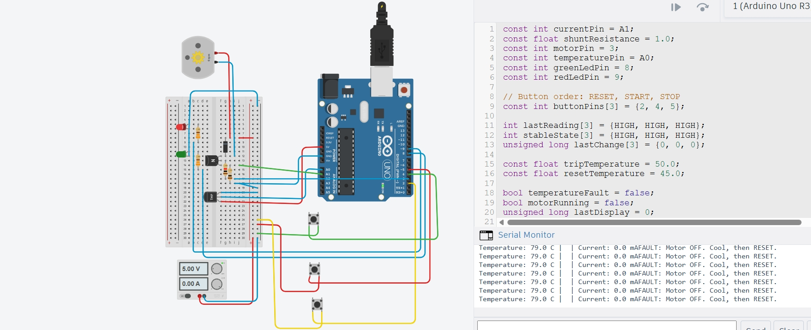

# Motor Condition Monitoring & Protection

This project explores how to monitor a DC motor, detect faults, and document recovery after a shutdown. It has two parts:

- **Arduino Uno:** I built a physical breadboard prototype and tested the circuit behavior separately in Tinkercad.
- **Python/Streamlit:** I built a dashboard to demonstrate motor monitoring and fault handling with simulated data. It was not connected to the Arduino prototype.

## Arduino Prototype and Tinkercad Tests

The Arduino circuit monitors motor current and temperature. The Tinkercad tests covered normal operation, overcurrent shutdown, overtemperature shutdown, and manual reset after a fault. The results below are from simulation, not hardware testing.

[View the Tinkercad circuit schematic (PDF)](Arduino%20Motor%20Condition%20Monitoring%20and%20Protection%20Prototype.pdf)

### Normal Operation

The green LED is on, and the Serial Monitor reports `RUNNING` and `Motor commanded ON`.

### Overtemperature Shutdown

The simulated temperature reached 79.0 °C, above the 50 °C trip threshold. The red fault LED turned on, and the Serial Monitor reported `FAULT` and `0.0 mA`.

## Python/Streamlit Dashboard Simulation

The dashboard displays simulated temperature and current. **Only temperature triggers a shutdown in the dashboard.** Current is displayed for monitoring and does not trigger a trip.

1. **Normal operation:** The simulated motor is running with no active alerts or previous faults.

   

2. **Temperature trip:** A simulated overtemperature fault stops the motor.

   

3. **Cooled but still stopped:** The temperature returns to normal, but the trip stays active and the motor remains stopped until a manual reset.

   

4. **[After manual reset](04_successful_reset.jpg):** The simulated motor is running again, but the previous fault remains in the history.

### Additional Test: Missing Temperature Data

