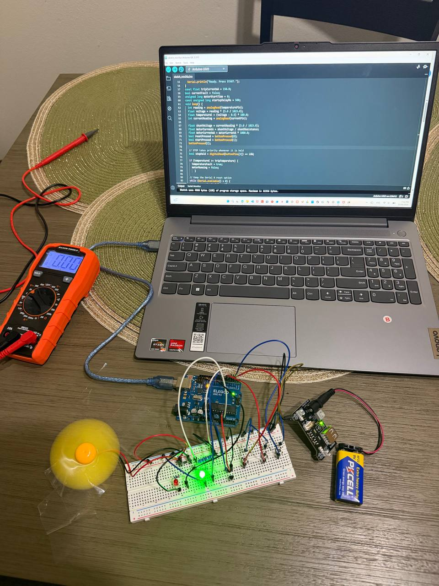
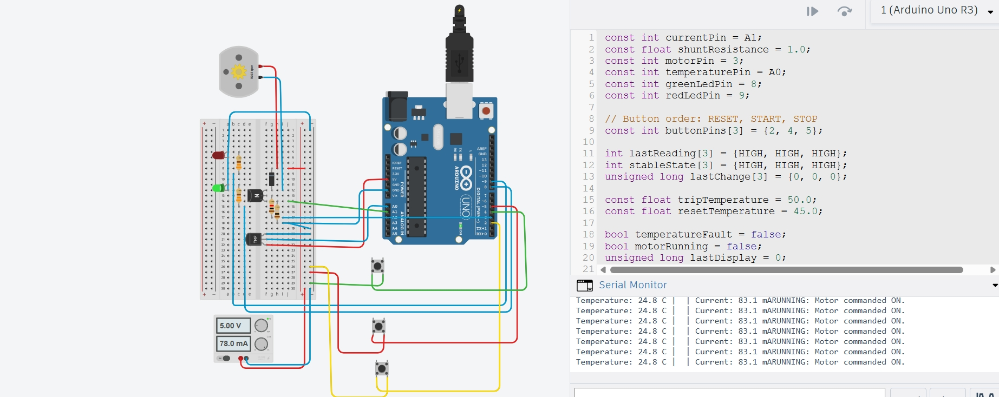
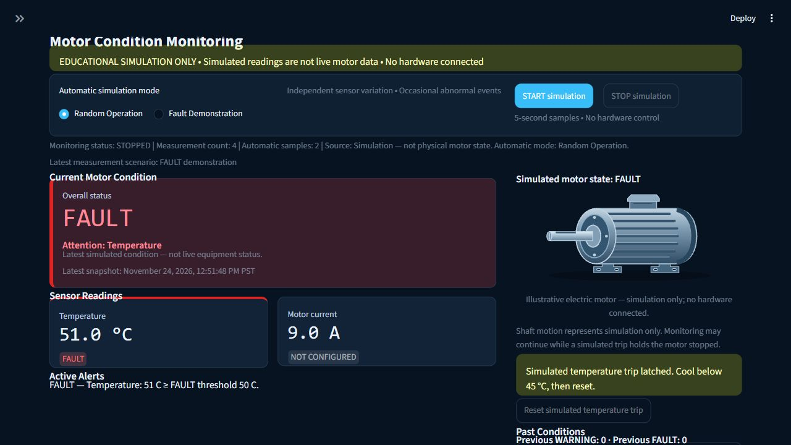
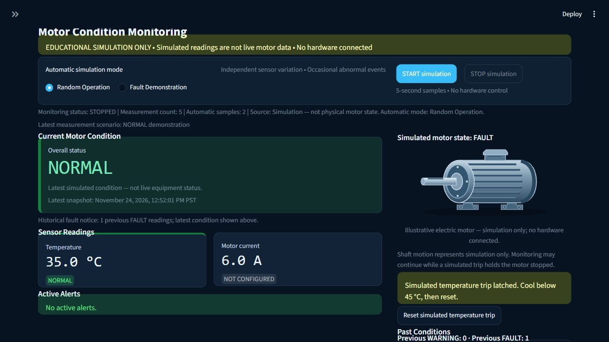
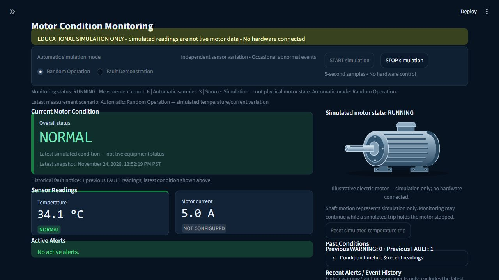
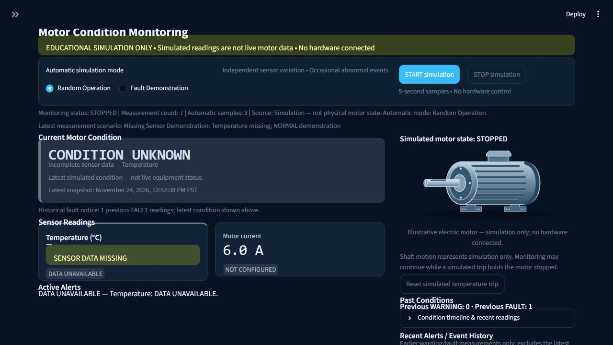

# Motor Condition Monitoring & Protection

I built an Arduino Uno breadboard prototype for DC motor monitoring and protection. I tested the circuit behavior separately in Tinkercad and built a Python/Streamlit dashboard to demonstrate fault handling with simulated data. The dashboard was not connected to the physical prototype.

## 1. Physical Arduino Prototype

The photo and video show the physical breadboard build with the motor running and the green run LED lit.

[Watch the physical motor demo (20 seconds)](physical-motor-demo.mp4)

The photo and video show the hardware running. The fault-test results below are from Tinkercad, not from the physical demo.

## 2. Tinkercad Circuit Tests

The Arduino circuit monitors motor current and temperature. I tested normal operation, overcurrent shutdown, overtemperature shutdown, and manual reset after a fault in Tinkercad.

[View the Tinkercad circuit schematic (PDF)](Arduino%20Motor%20Condition%20Monitoring%20and%20Protection%20Prototype.pdf)

### Normal Operation

The green LED is on, and the Serial Monitor reports `RUNNING: Motor commanded ON.`

### Overtemperature Shutdown

The simulated temperature reached 79.0 °C, above the 50 °C trip threshold. The motor stopped, the red fault LED turned on, and the Serial Monitor reported `FAULT` and `0.0 mA`.

## 3. Python/Streamlit Dashboard Simulation

The dashboard screenshots below use simulated readings, not live Arduino data. **In the version shown here, temperature triggers a simulated shutdown; current is displayed for monitoring only.** The Arduino circuit's overcurrent test is separate.

### 3.1 Normal Operation

The simulated motor is running with no active alerts or previous faults.

### 3.2 Temperature Trip

A simulated overtemperature fault stops the motor.

### 3.3 Cooled, but Fault Still Latched

The temperature reading returns to normal, but the fault stays active and the simulated motor remains stopped. Cooling alone does not clear the fault.

### 3.4 Recovery After Reset

This screenshot shows the simulated motor running again after recovery. The previous fault is still visible in the history.

### 3.5 Missing Temperature Data

This separate test shows how the dashboard reports an unavailable temperature reading.

