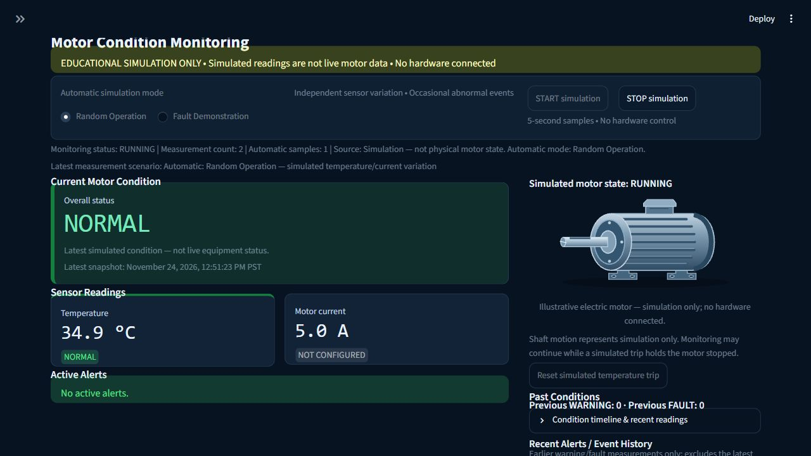

# Motor Condition Monitoring & Protection

This project has two parts: a physical Arduino Uno prototype with circuit tests performed in Tinkercad, and a Python/Streamlit dashboard that demonstrates motor monitoring and fault handling using simulated data. The dashboard was not connected to the physical prototype.

## Tests in Tinkercad

- Normal motor operation
- Overcurrent shutdown
- Overtemperature shutdown
- Manual reset after a fault
  
[View the Tinkercad circuit schematic (PDF)](Arduino%20Motor%20Condition%20Monitoring%20and%20Protection%20Prototype.pdf)

## Simulation and physical prototype

I simulated the Arduino Uno circuit in Tinkercad and also built a physical
prototype. The tests listed above were performed in Tinkercad.
## Python/Streamlit Dashboard Simulation

The dashboard uses simulated readings only. It displays motor current, but only temperature triggers a simulated trip.

[Successful reset](04_successful_reset.jpg) · [Missing temperature data](05_missing_temperature.jpg)
