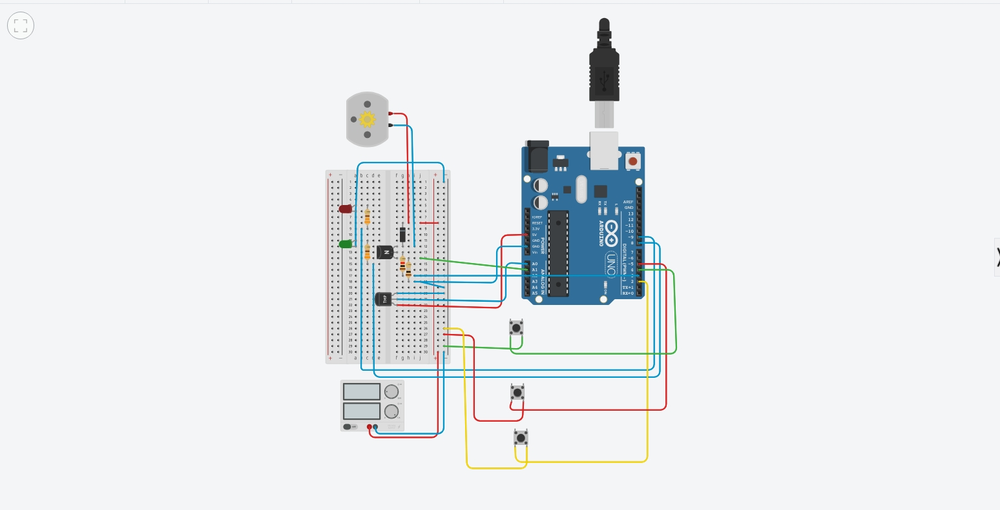

# Arduino Motor Condition Monitoring & Protection

This Arduino Uno project monitors a simulated DC motor’s current and temperature. It stops the motor when it detects overcurrent or overheating.

## Tests in Tinkercad

- Normal motor operation
- Overcurrent shutdown
- Overtemperature shutdown
- Manual reset after a fault
  
[View the Tinkercad circuit schematic (PDF)](Arduino%20Motor%20Condition%20Monitoring%20and%20Protection%20Prototype.pdf)

## Simulation and physical prototype

I simulated the Arduino Uno circuit in Tinkercad and also built a physical
prototype. The tests listed above were performed in Tinkercad.
